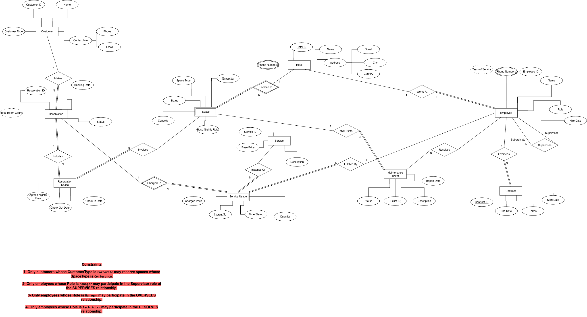
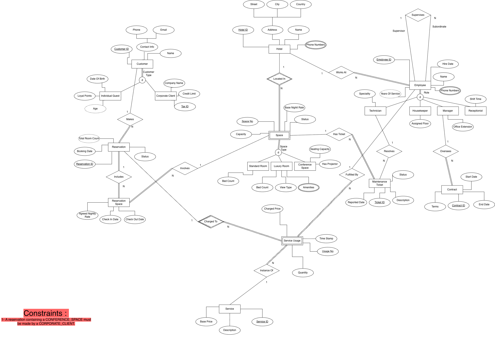

# Hotel Management Database

A PostgreSQL database project modeling hotel operations, including reservations, guest and corporate accounts, room and conference-space management, services, employees, and maintenance tickets.

Developed as a Database Systems course project (BIL 372).

## Highlights

- ER/EER modeling and relational schema design
- SQL constraints and referential integrity
- Sample records for local exploration
- SQL queries for operational analysis
- Views for reservation summaries, hotel occupancy, and service revenue
- PL/pgSQL triggers for reservation overlap prevention and corporate conference-booking restrictions

## Repository structure

```text
sql/01_schema_and_data.sql       Schema and sample records
sql/02_queries.sql               Basic and advanced SQL queries
sql/03_views_and_triggers.sql    Analytical views and triggers
diagrams/                         ER and EER diagrams
docs/database_design.md          Requirements and design documentation
```

## Setup (PostgreSQL)

Create a **dedicated test database**, then run the scripts in order:

```bash
createdb hotel_management_demo
psql -d hotel_management_demo -v ON_ERROR_STOP=1 -f sql/01_schema_and_data.sql
psql -d hotel_management_demo -v ON_ERROR_STOP=1 -f sql/03_views_and_triggers.sql
psql -d hotel_management_demo -v ON_ERROR_STOP=1 -f sql/02_queries.sql
```

**Warning:** The schema script contains `DROP TABLE IF EXISTS ... CASCADE`; do not run it against a database containing data you need to keep.

## Example analytics

- Guest reservation summary: `v_guest_reservation_summary`
- Hotel occupancy analysis: `v_hotel_occupancy_analysis`
- Service revenue analysis: `v_service_revenue_analysis`

See `sql/02_queries.sql` for additional SQL query examples.

## Database Diagrams

### Entity-Relationship (ER) Diagram

The ER diagram illustrates the main entities, attributes,
relationships, and cardinality constraints of the hotel
management system.



### Enhanced Entity-Relationship (EER) Diagram

The EER diagram extends the conceptual model with
specialization and generalization structures for customers,
employees, and accommodation spaces.

