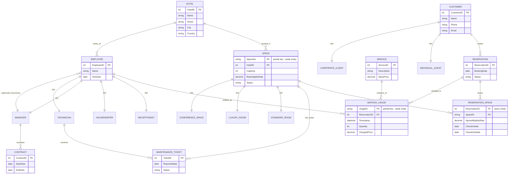

# BIL 372 – Database Systems Final Project
## Hotel Chain, Conference, and Service Management System

---

## 3.1 Requirement Analysis

### 3.1.1 Business Rule Assumptions

Since the mini-world description does not specify every operational detail, the following assumptions were made to close the gaps:

1. **Room pricing over time** – The nightly rate for a space is not fixed forever; it is negotiated at the moment of booking. Therefore, the agreed nightly rate is stored per reservation-space pair, not only on the SPACE entity, so historical reservations keep the price that was valid when they were made.
2. **Service pricing snapshot** – Each SERVICE has a current base/list price, but the price actually billed to a guest is captured at the moment the service is consumed (a "price snapshot"), since list prices may change after the charge already happened.
3. **Loyalty point eligibility** – Only individual guests accumulate loyalty points. Corporate clients are billed accounts and do not participate in the loyalty program.
4. **Conference space booking restriction** – Only CORPORATE customers are allowed to reserve CONFERENCE spaces; individual guests may only reserve STANDARD or LUXURY rooms.
5. **Employee shift management** – Detailed shift/roster scheduling (which employee works which hour) is out of scope; the system only tracks each employee's hire date, role, and the hotel they are assigned to.
6. **Maintenance ticket ownership** – A maintenance ticket is raised against exactly one space and, once assigned, is resolved by exactly one technician (no multi-technician tickets).
7. **Supervision scope** – A manager may only supervise employees working at the same hotel property; cross-hotel supervision is not modeled.

### 3.1.2 Major System Users

| User | Information Needed |
|---|---|
| **Receptionist** | Room/space availability, guest check-in/out data, ability to create reservations and post service charges |
| **Corporate Account Manager** | Corporate client profile, credit standing, conference space availability and bookings |
| **Hotel/Property Manager** | Occupancy and revenue overview for their hotel, staff assigned to their property, contracts they oversee |
| **Technician** | Maintenance tickets assigned to them, space/equipment details |
| **Guest (self-service, if exposed)** | Their own reservation, billed services, and loyalty point balance |
| **Database Administrator** | Full schema access for constraint, trigger, and view maintenance |

### 3.1.3 Scope Boundaries

The system **does not** manage:
- Payment processing or integration with external payment gateways (only that a charge/amount was recorded)
- Payroll, benefits, or HR compensation management for employees
- Third-party channel-manager integrations (e.g., OTA booking sync such as Booking.com/Expedia)
- Marketing/CRM campaign management or guest communication/email systems
- Physical security systems (CCTV, key-card access logs)
- Housekeeping task-level scheduling (only that a housekeeper is assigned to a hotel/floor)

---

## 3.2 EER / ER Diagram

### 3.2.1 Entities and Attributes

| Entity | Key | Other Attributes | Notes |
|---|---|---|---|
| **HOTEL** | HotelID (PK) | Name, Address *(composite: Street, City, Country)*, {PhoneNumbers} *(multivalued)* | Strong entity |
| **SPACE** | SpaceNo (partial key) + HotelID (owner) | Capacity, BaseNightlyRate, Status | **Weak entity**, owned by HOTEL — space numbers repeat across properties |
| ├ STANDARD_ROOM | — | BedCount | Subtype of SPACE |
| ├ LUXURY_ROOM | — | BedCount, ViewType, {Amenities} *(multivalued)* | Subtype of SPACE |
| └ CONFERENCE_SPACE | — | SeatingCapacity, HasProjector | Subtype of SPACE |
| **CUSTOMER** | CustomerID (PK) | Name, ContactInfo *(composite: Phone, Email)* | Strong entity |
| ├ INDIVIDUAL_GUEST | — | LoyaltyPoints, DateOfBirth, Age *(derived)* | Subtype of CUSTOMER |
| └ CORPORATE_CLIENT | — | CompanyName, TaxID, CreditLimit | Subtype of CUSTOMER |
| **EMPLOYEE** | EmployeeID (PK) | Name, HireDate, {PhoneNumbers} *(multivalued)*, YearsOfService *(derived)* | Strong entity |
| ├ RECEPTIONIST | — | ShiftType | Subtype of EMPLOYEE |
| ├ HOUSEKEEPER | — | AssignedFloor | Subtype of EMPLOYEE |
| ├ MANAGER | — | OfficeExtension | Subtype of EMPLOYEE |
| └ TECHNICIAN | — | Specialty | Subtype of EMPLOYEE |
| **RESERVATION** | ReservationID (PK) | BookingDate, Status, TotalRoomCount *(derived)* | Strong entity |
| **RESERVATION_SPACE** | ReservationID + SpaceID (composite PK) | AgreedNightlyRate, CheckInDate, CheckOutDate | **Associative entity** — resolves the M:N between RESERVATION and SPACE |
| **SERVICE** | ServiceID (PK) | Description, BasePrice | Strong entity (catalog) |
| **SERVICE_USAGE** | UsageID (partial key) + ReservationID (owner) | Timestamp, Quantity, ChargedPrice | **Weak entity**, owned by RESERVATION |
| **MAINTENANCE_TICKET** | TicketID (PK) | ReportedDate, Description, Status | Strong entity |
| **CONTRACT** | ContractID (PK) | StartDate, EndDate, Terms | Strong entity |

### 3.2.2 Relationships, Cardinalities, and Participation

| Relationship | Between | Cardinality | Participation |
|---|---|---|---|
| LOCATED_IN (identifying) | HOTEL – SPACE | 1 : N | SPACE total, HOTEL partial |
| WORKS_AT | HOTEL – EMPLOYEE | 1 : N | EMPLOYEE total, HOTEL partial |
| MAKES | CUSTOMER – RESERVATION | 1 : N | RESERVATION total, CUSTOMER partial |
| BOOKS (associative) | RESERVATION – SPACE via RESERVATION_SPACE | M : N | both partial |
| INSTANCE_OF | SERVICE – SERVICE_USAGE | 1 : N | SERVICE_USAGE total, SERVICE partial |
| CHARGED_TO (identifying) | RESERVATION – SERVICE_USAGE | 1 : N | SERVICE_USAGE total, RESERVATION partial |
| FULFILLED_BY | EMPLOYEE – SERVICE_USAGE | 1 : N | SERVICE_USAGE total, EMPLOYEE partial |
| HAS_TICKET | SPACE – MAINTENANCE_TICKET | 1 : N | MAINTENANCE_TICKET total, SPACE partial |
| RESOLVES | TECHNICIAN – MAINTENANCE_TICKET | 1 : N | both partial (ticket may be unassigned) |
| OVERSEES | MANAGER – CONTRACT | 1 : N | CONTRACT total, MANAGER partial |
| **SUPERVISES (recursive)** | MANAGER – EMPLOYEE | 1 : N | both partial (top manager supervises no one; some employees are unsupervised) |

### 3.2.3 Specialization / Generalization Constraints

| Hierarchy | Constraint | Justification |
|---|---|---|
| SPACE → {STANDARD_ROOM, LUXURY_ROOM, CONFERENCE_SPACE} | **Disjoint, Total** | Every space is exactly one physical type; a room cannot simultaneously be a conference space |
| CUSTOMER → {INDIVIDUAL_GUEST, CORPORATE_CLIENT} | **Disjoint, Total** | A customer account is registered as exactly one of the two kinds |
| EMPLOYEE → {RECEPTIONIST, HOUSEKEEPER, MANAGER, TECHNICIAN} | **Disjoint, Total** | Each employee is hired into exactly one specialized operational role |

### 3.2.4 Mermaid Diagram (visual reference)

> Mermaid's `erDiagram` cannot render ISA/specialization triangles natively, so subtype boxes are linked to their supertype with a labeled `ISA` relationship as a visual convention. Weak entities are marked `(weak)`; the associative entity is marked `(assoc)`.



### 3.2.5 Checklist against requirements

- ✅ Specialization hierarchies (≥2): SPACE, CUSTOMER, EMPLOYEE — all disjoint/total, justified above
- ✅ Associative entity (M:N): RESERVATION_SPACE
- ✅ Weak entity (semantically justified): SPACE (owned by HOTEL), SERVICE_USAGE (owned by RESERVATION)
- ✅ Recursive relationship: SUPERVISES on EMPLOYEE/MANAGER
- ✅ Composite attributes: HOTEL.Address, CUSTOMER.ContactInfo
- ✅ Multivalued attributes: HOTEL.PhoneNumbers, EMPLOYEE.PhoneNumbers, LUXURY_ROOM.Amenities
- ✅ Derived attributes: INDIVIDUAL_GUEST.Age, EMPLOYEE.YearsOfService, RESERVATION.TotalRoomCount
- ✅ Keys, cardinality ratios, min/max participation, specialization constraints: documented in 3.2.2 / 3.2.3

---

## 3.4 Normalization Task

### Working set of functional dependencies

Given FDs, plus one reasonable additional FD justified by the domain (a service-usage event belongs to exactly one invoice/stay):

```
f1: InvoiceNo -> InvoiceDate, ReservationID, TotalAmount
f2: ReservationID -> GuestID, HotelID, CheckInDate, CheckOutDate
f3: GuestID -> GuestName, GuestLoyaltyPoints
f4: HotelID -> HotelName, HotelAddress
f5: (HotelID, RoomNo) -> RoomType, RoomRate
f6: ServiceUsageID -> ServiceID, ServiceQuantity, ServiceUnitPrice, ServiceTimestamp, EmployeeID
f7: ServiceID -> ServiceDescription
f8: EmployeeID -> EmployeeName, EmployeeRole
f9 (additional, reasonable): ServiceUsageID -> InvoiceNo   -- a recorded service usage belongs to exactly one invoice/stay
```

**Derived (transitive) FD used below:** by f1 (InvoiceNo→ReservationID), f2 (ReservationID→HotelID), and f5, pseudo-transitivity gives **InvoiceNo, RoomNo → RoomType, RoomRate**. This lets us split the raw 1NF relation mechanically at the 2NF stage; it is *not* the smallest determinant — that distinction is the whole point of the BCNF step below.

### Candidate key of the raw (1NF) relation

None of the given FDs determine `RoomNo` or `ServiceUsageID` from anything else (a reservation can include several rooms; an invoice can include several service usages), so both must be part of any key. Checking closure:

`{InvoiceNo, RoomNo, ServiceUsageID}+` → via f1,f2,f3,f4 → all invoice/reservation/guest/hotel attributes; via f5 (using the derived form) → RoomType, RoomRate; via f6,f7,f8 → all service/employee attributes. This closure = the full attribute set, and no 2-attribute subset closes to everything (e.g. `{InvoiceNo,RoomNo}+` never reaches ServiceUsageID's group, and vice versa) → this is the **only candidate key**, and it is minimal.

**PK(1NF) = {InvoiceNo, RoomNo, ServiceUsageID}**

---

### Step 0 → 1NF

The raw log has two independent repeating groups inside a single invoice: the set of booked rooms `(RoomNo, RoomType, RoomRate)` and the set of consumed services `(ServiceUsageID, ServiceID, ... , EmployeeID, ...)`. Flattening these into atomic, single-valued rows (one row per room × service-usage combination for a given invoice) gives 1NF, at the cost of a large amount of redundancy (guest/hotel/invoice data repeated on every room/service row) — this is exactly the "overlapping data" the task description warns about.

**1NF relation:** `UNNORMALIZED_GUEST_INVOICE(InvoiceNo, InvoiceDate, ReservationID, GuestID, GuestName, GuestLoyaltyPoints, HotelID, HotelName, HotelAddress, CheckInDate, CheckOutDate, RoomNo, RoomType, RoomRate, ServiceUsageID, ServiceID, ServiceDescription, ServiceQuantity, ServiceUnitPrice, ServiceTimestamp, EmployeeID, EmployeeName, EmployeeRole, TotalAmount)`
**PK:** {InvoiceNo, RoomNo, ServiceUsageID}

---

### Step 1NF → 2NF (remove partial dependencies)

A **partial dependency** = a non-key attribute depends on a *proper subset* of the composite key. Checking every non-key attribute against the 3-part key:

| Attribute group | Depends on | Proper subset of key? | Violation |
|---|---|---|---|
| InvoiceDate, ReservationID, TotalAmount | {InvoiceNo} | yes | **Partial** |
| GuestID, HotelID, CheckInDate, CheckOutDate (via f1+f2) | {InvoiceNo} | yes | **Partial** |
| GuestName, GuestLoyaltyPoints (via f1+f2+f3) | {InvoiceNo} | yes | **Partial** |
| HotelName, HotelAddress (via f1+f2+f4) | {InvoiceNo} | yes | **Partial** |
| RoomType, RoomRate (derived FD) | {InvoiceNo, RoomNo} | yes (missing ServiceUsageID) | **Partial** |
| ServiceID, ServiceQuantity, ServiceUnitPrice, ServiceTimestamp, EmployeeID | {ServiceUsageID} | yes | **Partial** |
| ServiceDescription (via f6+f7), EmployeeName, EmployeeRole (via f6+f8) | {ServiceUsageID} | yes | **Partial** |

Every non-key attribute is partially dependent — the relation is far from 2NF. Decompose by grouping attributes with the determinant established above:

- **INVOICE_HEADER**(InvoiceNo, InvoiceDate, ReservationID, TotalAmount, GuestID, HotelID, CheckInDate, CheckOutDate, GuestName, GuestLoyaltyPoints, HotelName, HotelAddress) — PK: InvoiceNo
- **ROOM_BOOKING**(InvoiceNo, RoomNo, RoomType, RoomRate) — PK: (InvoiceNo, RoomNo)
- **SERVICE_USAGE**(ServiceUsageID, InvoiceNo, ServiceID, ServiceQuantity, ServiceUnitPrice, ServiceTimestamp, EmployeeID, ServiceDescription, EmployeeName, EmployeeRole) — PK: ServiceUsageID

Each relation's non-key attributes now depend on its **entire** key (a single-attribute key can't have a "proper subset," and RoomType/RoomRate genuinely need both InvoiceNo *and* RoomNo in this grouping). **2NF achieved.**

---

### Step 2NF → 3NF (remove transitive dependencies)

A **transitive dependency** = a non-key attribute depends on *another non-key attribute* rather than directly on the key.

**INVOICE_HEADER** (key = InvoiceNo): `ReservationID` is itself non-key, yet `GuestID, HotelID, CheckInDate, CheckOutDate` depend on `ReservationID` (not directly on InvoiceNo) → **transitive violation**. Likewise `GuestID → GuestName, GuestLoyaltyPoints` and `HotelID → HotelName, HotelAddress` are further transitive chains hanging off non-key attributes. Decompose:

- **INVOICE**(InvoiceNo, InvoiceDate, ReservationID, TotalAmount)
- **RESERVATION**(ReservationID, GuestID, HotelID, CheckInDate, CheckOutDate)
- **GUEST**(GuestID, GuestName, GuestLoyaltyPoints)
- **HOTEL**(HotelID, HotelName, HotelAddress)

**ROOM_BOOKING** (key = InvoiceNo, RoomNo): checked against its *own* attribute set {InvoiceNo, RoomNo, RoomType, RoomRate}, there is no other non-key attribute for RoomType/RoomRate to hang off — by this local test it already looks like 3NF. **Flagged for re-examination at the BCNF step below**, because the given FD f5 says the true determinant is (HotelID, RoomNo), not (InvoiceNo, RoomNo), and HotelID isn't even present as a column here yet.

**SERVICE_USAGE** (key = ServiceUsageID): `ServiceID` and `EmployeeID` are non-key, yet `ServiceDescription` depends on `ServiceID` and `EmployeeName, EmployeeRole` depend on `EmployeeID` → **transitive violations**. Decompose:

- **SERVICE_USAGE**(ServiceUsageID, InvoiceNo, ServiceID, ServiceQuantity, ServiceUnitPrice, ServiceTimestamp, EmployeeID)
- **SERVICE**(ServiceID, ServiceDescription)
- **EMPLOYEE**(EmployeeID, EmployeeName, EmployeeRole)

**Result — 7 relations, all satisfying the local 3NF test:** INVOICE, RESERVATION, GUEST, HOTEL, ROOM_BOOKING, SERVICE_USAGE, SERVICE, EMPLOYEE.

---

### Step 3NF → BCNF (every determinant must be a superkey)

Checking each relation's non-trivial FDs against its own candidate key(s):

| Relation | FD | Determinant a superkey? |
|---|---|---|
| INVOICE | InvoiceNo → rest | yes (key) ✅ |
| RESERVATION | ReservationID → rest | yes (key) ✅ |
| GUEST | GuestID → rest | yes (key) ✅ |
| HOTEL | HotelID → rest | yes (key) ✅ |
| SERVICE_USAGE | ServiceUsageID → rest | yes (key) ✅ |
| SERVICE | ServiceID → ServiceDescription | yes (key) ✅ |
| EMPLOYEE | EmployeeID → rest | yes (key) ✅ |
| **ROOM_BOOKING** | (HotelID, RoomNo) → RoomType, RoomRate | **HotelID is derivable here** (InvoiceNo → ReservationID → HotelID), so it legitimately belongs among ROOM_BOOKING's attributes. Once included, {HotelID, RoomNo} → RoomType, RoomRate holds, but **{HotelID, RoomNo} is *not* a superkey** of ROOM_BOOKING (it does not determine InvoiceNo) → **BCNF violation** |

This is the one genuine BCNF-only violation, and it is exactly the trap the assignment's FD (HotelID, RoomNo) → RoomType, RoomRate is designed to expose: {InvoiceNo, RoomNo} *does* functionally determine RoomType/RoomRate (via the derived FD), so a purely local, syntactic 3NF check on ROOM_BOOKING(InvoiceNo, RoomNo, RoomType, RoomRate) alone appears to pass. But RoomType/RoomRate are really intrinsic properties of a *physical room* (HotelID, RoomNo), independent of which invoice happens to reference it — keeping them keyed by (InvoiceNo, RoomNo) means:
- **Update anomaly:** changing a room's rate requires updating it on every invoice row that ever booked that room.
- **Insertion anomaly:** a newly-created room's type/rate cannot be recorded until it appears on an invoice.
- **Deletion anomaly:** deleting the last invoice referencing a room silently deletes the room's type/rate.

**BCNF decomposition** of ROOM_BOOKING:

- **ROOM**(HotelID, RoomNo, RoomType, RoomRate) — PK (HotelID, RoomNo); matches the given FD exactly; every determinant is now a key.
- **INVOICE_ROOM**(InvoiceNo, RoomNo) — PK (InvoiceNo, RoomNo); the bridge fact "this invoice's stay included this room." No non-key attributes, so it trivially satisfies BCNF. (HotelID is intentionally *not* stored here — re-adding it would reopen a partial dependency, since InvoiceNo alone already determines HotelID; referential integrity to ROOM should instead be enforced by a check that the room's hotel matches the invoice's reservation hotel.)

**Lossless-join check** (common-attribute-is-a-key test) for every split performed: INVOICE ∩ RESERVATION = {ReservationID} (key of RESERVATION) ✅; RESERVATION ∩ GUEST = {GuestID} (key of GUEST) ✅; RESERVATION ∩ HOTEL = {HotelID} (key of HOTEL) ✅; ROOM_BOOKING ∩ ROOM = {HotelID, RoomNo} (key of ROOM) ✅; SERVICE_USAGE ∩ SERVICE = {ServiceID} (key of SERVICE) ✅; SERVICE_USAGE ∩ EMPLOYEE = {EmployeeID} (key of EMPLOYEE) ✅ — all decompositions are lossless.

**Dependency-preservation note:** every FD is preserved *within a single relation* except the derived (InvoiceNo, RoomNo) → RoomType, RoomRate, which can now only be checked by joining INVOICE_ROOM with ROOM. This is a known, acceptable trade-off — BCNF guarantees losslessness but not always full dependency preservation.

---

### Final BCNF schema (9 relations)

```
INVOICE(InvoiceNo PK, InvoiceDate, ReservationID FK, TotalAmount)
RESERVATION(ReservationID PK, GuestID FK, HotelID FK, CheckInDate, CheckOutDate)
GUEST(GuestID PK, GuestName, GuestLoyaltyPoints)
HOTEL(HotelID PK, HotelName, HotelAddress)
ROOM(HotelID FK, RoomNo, RoomType, RoomRate)                 -- PK (HotelID, RoomNo)
INVOICE_ROOM(InvoiceNo FK, RoomNo)                            -- PK (InvoiceNo, RoomNo)
SERVICE_USAGE(ServiceUsageID PK, InvoiceNo FK, ServiceID FK, ServiceQuantity, ServiceUnitPrice, ServiceTimestamp, EmployeeID FK)
SERVICE(ServiceID PK, ServiceDescription)
EMPLOYEE(EmployeeID PK, EmployeeName, EmployeeRole)
```

All nine relations are simultaneously in 3NF and BCNF.